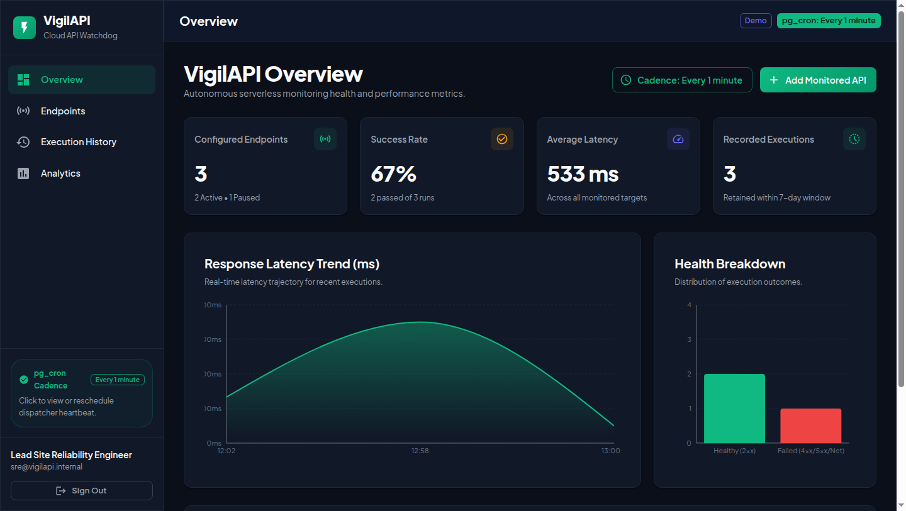

# VigilAPI — Production-Minded Serverless API Monitoring Platform


**Live Web Application**: [https://amitbora007.github.io/vigilapi/](https://amitbora007.github.io/vigilapi/)

VigilAPI is a production-minded, multi-tenant HTTP endpoint health monitoring web application built on **React, TypeScript, Supabase PostgreSQL, Supabase Cron (`pg_cron`), and Supabase Edge Functions**.

It runs scheduled HTTP health checks **100% independently of client sessions**. Users can close their browser, log out, or shut down their computer without interrupting monitoring schedules.

<p align="center">
  
</p>

---

## Key Features

- **Browser-Independent Infrastructure Scheduling**: Driven by PostgreSQL `pg_cron` and Supabase Edge Functions. Zero reliance on browser tabs or client-side timers.
- **Zero Cost (Free Tier Eligible)**: Engineered to operate comfortably within Supabase's Free Tier quotas (500k function invocations/mo, 500 MB storage).
- **Atomic Claim-and-Lease Concurrency**: Uses PostgreSQL `FOR UPDATE SKIP LOCKED` and expiring leases (`lease_expires_at`) to guarantee zero duplicate executions and automatic worker failure recovery.
- **Deterministic Non-Storm Catch-Up**: Overdue endpoints resume their cadence smoothly without generating request storms.
- **SSRF Defense-in-Depth**: Multi-layer protection against Server-Side Request Forgery, blocking RFC 1918 private IPs, AWS/GCP/Azure metadata (`169.254.169.254`), loopbacks, IPv6 variations, and obfuscated octal/hex encodings.
- **Zero Secret Leakage**: Hop-by-hop header stripping, regex-based secret redaction, and strict response header allowlisting.
- **Enterprise SaaS Dashboard**: Polished Material UI interface with live status chips, dynamic Recharts visualizations (latency trends & volume breakdown), manual run triggers, and a safe JSON response inspector.
- **Automated Retention**: Daily pg_cron job purges execution logs older than 7 days, preventing unbounded database growth.

---

## Architecture Diagram

```
+--------------------------------------------------------------------+
| BROWSER: React 19 + TypeScript + MUI + TanStack Query              |
| - Authenticated Endpoint Management (CRUD)                         |
| - Real-time Execution History & Latency Trends (Recharts)          |
| - Safe JSON Response Viewer (No arbitrary HTML rendering)          |
+---------------------------------+----------------------------------+
                                  | Supabase Client (RLS Protected)
                                  v
+--------------------------------------------------------------------+
| SUPABASE POSTGRESQL (15+)                                          |
| - tables: profiles, monitored_endpoints, endpoint_executions       |
| - RPC claim_due_endpoints() (FOR UPDATE SKIP LOCKED)               |
| - RPC record_execution_and_reschedule() (Bounded catch-up)         |
| - pg_cron: Dispatcher Trigger (* * * * *)                          |
| - pg_cron: Daily Retention Cleanup (0 3 * * *)                     |
+---------------------------------+----------------------------------+
                                  | pg_net.http_post() with Secret
                                  v
+--------------------------------------------------------------------+
| SUPABASE EDGE FUNCTION (Deno/TypeScript Dispatcher)               |
| - Validates X-Scheduler-Secret                                     |
| - Claims batch of due endpoints (Atomic lease)                     |
| - Enforces SSRF & DNS pre-resolution checks                        |
| - Bounded concurrent HTTP GET execution with AbortController       |
| - Sanitizes headers and truncates bodies to 32 KB                  |
| - Persists execution records & reschedules next_run_at             |
+--------------------------------------------------------------------+
```

---

## Project Structure

```
.
├── docs/
│   ├── ARCHITECTURE.md          # Full architectural specification
│   ├── DESIGN.md                # Schema, DDL, RLS, and SSRF rules
│   ├── AGENTS.md                # Autonomous worker contracts & state machines
│   └── BUGS.md                  # Concurrency, edge cases & vulnerability analysis
├── supabase/
│   ├── migrations/
│   │   └── 20240101000000_init_schema.sql  # Schema, RLS, RPCs & Cron
│   └── functions/
│       ├── _shared/
│       │   ├── ssrf.ts          # SSRF & IP CIDR validation engine
│       │   ├── headers.ts       # Header sanitization & secret redaction
│       │   └── types.ts         # TypeScript shared database types
│       └── dispatcher/
│           └── index.ts         # Main Edge Function dispatcher & worker pool
├── src/
│   ├── app/
│   │   ├── App.tsx              # Root component & providers
│   │   ├── routes.tsx           # React Router route tree
│   │   └── theme.ts             # Custom dark/light MUI SaaS theme
│   ├── components/
│   │   ├── common/              # MetricCard, JsonViewer, StatusChip, etc.
│   │   └── layout/              # AppLayout, Sidebar, Navbar
│   ├── features/
│   │   ├── auth/                # AuthContext, LoginForm, ProtectedRoute
│   │   ├── dashboard/           # Overview metrics, Latency/Volume charts
│   │   ├── endpoints/           # EndpointsListPage, EndpointFormModal
│   │   ├── executions/          # ExecutionHistoryPage, ExecutionDetailModal
│   │   └── analytics/           # Deep dive metrics & percentile charts
│   ├── lib/
│   │   ├── supabaseClient.ts    # Supabase browser client
│   │   ├── ssrfValidator.ts     # Client-side validation preview
│   │   └── formatters.ts        # Date, latency, and status formatters
│   └── types/
│       └── index.ts             # Domain & DB type definitions
├── tests/
│   ├── unit/                    # SSRF, headers, scheduling & catch-up tests
│   └── components/              # React Testing Library form & auth tests
├── .env.example
├── package.json
├── tsconfig.json
└── vite.config.ts
```

---

## Quickstart & Local Development

### 1. Prerequisites
- **Node.js**: v18+ (tested on v22.14.0)
- **npm**: v9+
- **Supabase CLI**: (optional for local emulation)

### 2. Install Dependencies
```bash
npm install
```

### 3. Configure Environment Variables
Copy `.env.example` to `.env`:
```bash
cp .env.example .env
```
Populate `.env` with your Supabase credentials:
```env
VITE_SUPABASE_URL=https://your-project.supabase.co
VITE_SUPABASE_ANON_KEY=your-anon-key
```

### 4. Run the Development Server
```bash
npm run dev
```
Open [http://localhost:5173](http://localhost:5173) in your browser.

### 5. Run the Automated Test Suite
```bash
# Run unit tests and component tests
npm test

# Run tests with coverage
npm run test:coverage

# Run TypeScript type check
npm run typecheck
```

---

## Supabase Cloud Deployment Guide

Follow these steps to deploy VigilAPI to a free Supabase project:

### Step 1: Create a Supabase Project
1. Go to [https://database.new](https://database.new) and create a free project.
2. Note your **Project URL** and **API Keys** (`anon` public and `service_role` secret) in `Project Settings -> API`.

### Step 2: Apply Database Migrations
1. In the Supabase Dashboard, open the **SQL Editor**.
2. Paste the contents of [`supabase/migrations/20240101000000_init_schema.sql`](supabase/migrations/20240101000000_init_schema.sql) and run it.
3. This creates all tables (`profiles`, `monitored_endpoints`, `endpoint_executions`), security triggers, RLS policies, indexes, and stored procedures (`claim_due_endpoints`, `record_execution_and_reschedule`, `purge_expired_executions`).

### Step 3: Deploy the Edge Function
Using the Supabase CLI:
```bash
# Login to Supabase CLI
npx supabase login

# Link your remote project
npx supabase link --project-ref your-project-id

# Set Edge Function secret for scheduler invocation
npx supabase secrets set SCHEDULER_SECRET=generate-a-random-32-char-secret

# Deploy the dispatcher function
npx supabase functions deploy dispatcher --no-verify-jwt
```

### Step 4: Register the pg_cron Recurring Job
In the Supabase SQL Editor, store your configuration and schedule the cron:
```sql
-- 1. Store secrets in Supabase Vault or app settings
SELECT vault.create_secret('https://<your-project-id>.supabase.co/functions/v1', 'edge_function_url');
SELECT vault.create_secret('<your-random-32-char-secret>', 'scheduler_secret');

-- 2. Schedule the 1-minute dispatcher trigger
SELECT cron.schedule(
  'vigilapi-minute-dispatcher',
  '* * * * *',
  $$
  SELECT net.http_post(
    url := (SELECT decrypted_secret FROM vault.decrypted_secrets WHERE name = 'edge_function_url') || '/dispatcher',
    headers := jsonb_build_object(
      'Content-Type', 'application/json',
      'X-Scheduler-Secret', (SELECT decrypted_secret FROM vault.decrypted_secrets WHERE name = 'scheduler_secret')
    ),
    body := '{"batch_size": 50, "lease_seconds": 120}'::jsonb
  );
  $$
);

-- 3. Schedule daily retention cleanup at 03:00 UTC
SELECT cron.schedule(
  'vigilapi-daily-retention-purge',
  '0 3 * * *',
  $$ SELECT purge_expired_executions(7); $$
);
```

> [!TIP]
> **Rescheduling the Dispatcher**: You can change the cron cadence anytime directly from the **VigilAPI Dashboard** using the **"Cadence"** button or topbar `pg_cron` chip (e.g., switch between 1m, 2m, 3m, 5m, 10m). Alternatively, run `SELECT cron.alter_job(job_id := (SELECT jobid FROM cron.job WHERE jobname = 'vigilapi-minute-dispatcher'), schedule := '*/3 * * * *');` in the Supabase SQL editor.

---

## Smoke-Test Verification Procedure

To verify that monitoring runs independently of any client session:

1. Log into your VigilAPI instance and create a new endpoint:
   - **Name**: `HttpBin Test`
   - **URL**: `https://httpbin.org/get`
   - **Interval**: `5 minutes`
   - **Timeout**: `10 seconds`
2. Click **"Run Test"** or wait for the next minute dispatcher run.
3. Verify that the execution appears in the **Execution History** tab with status `200 OK` and recorded latency.
4. **The Shutdown Test**:
   - Log out of VigilAPI.
   - Close all browser tabs and close the browser completely.
   - Wait 15 minutes.
5. Re-open your browser and log back in.
6. Open **Execution History**: Notice that 3 new executions were recorded in PostgreSQL at exactly 5-minute intervals while your machine was closed and offline!

---

## Free Tier Quota Analysis & Guarantees

| Resource | Supabase Free Limit | VigilAPI Design Budget | Headroom |
| :--- | :--- | :--- | :--- |
| **Edge Function Invocations** | 500,000 / month | 43,200 / month ($1/\text{min}$) | **91.4% Headroom** |
| **Database Storage** | 500 MB | ~15-20 MB (20 endpoints $\times 7$ days) | **96% Headroom** |
| **Database Egress** | 5 GB / month | < 250 MB / month | **95% Headroom** |
| **Function Concurrency** | 100 max | 10 bounded workers | **10x Safety Buffer** |

> [!NOTE]
> **Project Pausing Prevention**: Supabase free projects pause after 7 days without database activity. Because VigilAPI's `pg_cron` dispatcher runs database queries every minute, your project **remains active automatically** as long as you have at least one active monitored endpoint!

---

## License

MIT License. Engineered for maximum reliability, security, and developer productivity.
