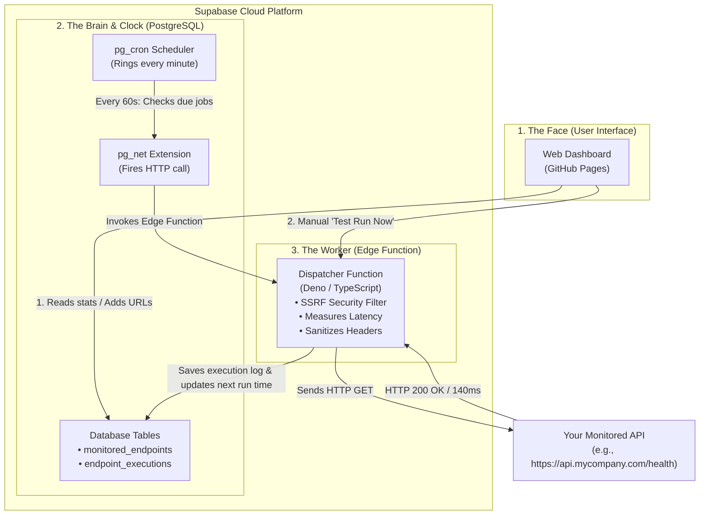

# VigilAPI: How It Works & How Supabase Is Used for Deployment
*A Plain-English Architectural Guide for Everyone*

---

## 1. The Big Picture: What is This Project?

Imagine you own an online store or a SaaS application. If your payment system or backend server goes down at 3:00 AM, how do you find out? Usually, you only find out when angry customers email you.

**VigilAPI** (the `vigilapi` codebase) is an **Autonomous API Watchdog**. It acts like a robotic security guard that knocks on your server's door every 5 or 10 minutes:
1. It sends an HTTP request (like a health check ping) to your API endpoint.
2. It checks: *Did it respond? Did it return HTTP 200 OK or an error? How many milliseconds did it take?*
3. It records the test results and displays live uptime metrics, charts, and error diagnostic logs on a web dashboard.

### The Engineering Challenge
Traditionally, running a monitor like this requires renting a Linux server (like an AWS EC2 instance or a DigitalOcean droplet) that runs 24/7, running background software (like Celery, Node.js workers, or Redis). That costs money every month and requires constant server patching.

**VigilAPI is built to be 100% Serverless and \$0/Month**:
- **Zero permanent servers**: No machines running 24/7.
- **Runs even with your laptop and browser closed**: It does not depend on your computer.
- **Hosted on free cloud tiers**: GitHub Pages for the web interface and Supabase for database, scheduling, and serverless compute.

---

## 2. The 3 Core Pillars of the Architecture

To understand how the system works without any permanent servers, think of it as 3 collaborating components:



---

### Pillar 1: The Face (Frontend Web Dashboard)
- **What it is**: The visual dashboard where you log in, add monitored URLs, set monitoring cadences (5m, 10m, 1h), see latency graphs, and review incident alerts.
- **Technology**: Built with React, TypeScript, Material UI (MUI), and Recharts.
- **Responsive Architecture**: Includes mobile-adaptive dual rendering (stacked cards on mobile, horizontally-scrollable tables on desktop) and responsive pagination across all four views (Recent Incident Alerts, Endpoints, Execution History, Analytics).
- **Where it lives**: Hosted for free on **GitHub Pages** (`https://amitbora007.github.io/vigilapi/`).
- **How it works**: Whenever you open the page in your phone or browser, it connects securely to Supabase using public API keys and your login credentials to fetch your real-time data using chunked range querying.

---

### Pillar 2: The Brain & Alarm Clock (Supabase PostgreSQL Database)
- **What it is**: The permanent cloud memory and brain of the system.
- **What it stores**:
  - `monitored_endpoints`: Stores each URL you want to test, the check interval (e.g., every 300 seconds), and a timestamp called `next_run_at`.
  - `endpoint_executions`: A flight-recorder log of every test ever run (timestamp, HTTP status code 200/500, response latency in milliseconds, error messages, and response headers).
  - `auth.users`: Handled by Supabase Auth so each user has their own password, session, and private data (guaranteed by PostgreSQL Row Level Security).
- **The Secret Weapon (`pg_cron`)**:
  - PostgreSQL has an extension called `pg_cron`—essentially an **alarm clock built directly inside the database**.
  - Every 60 seconds, `pg_cron` wakes up inside PostgreSQL and asks:
    > *"Are there any endpoints where `next_run_at <= NOW()`?"*
  - If yes, PostgreSQL triggers the `pg_net` extension to make an HTTP call that wakes up the serverless worker.

---

### Pillar 3: The Worker (Supabase Edge Function: `dispatcher`)
- **What it is**: A lightweight, serverless script written in TypeScript that runs on Deno in Supabase's global cloud.
- **Why we need it**: Databases are designed to store data, not make hundreds of external web requests. The Edge Function acts as the hands and feet of the database.
- **What it does when it wakes up**:
  1. **SSRF Security Check**: Verifies that the URL is a legitimate public website. It actively blocks requests to `localhost`, internal networks (`192.168.x.x`), or cloud metadata IPs (`169.254.169.254`), preventing bad actors from abusing the system.
  2. **Claims Due Endpoints**: Asks the database for any endpoints that need to be tested right now and locks them with a temporary lease so other workers won't test the same URL at the same time.
  3. **Dispatches the HTTP Request**: Calls the target API with a strict timeout limit (e.g., 10 seconds).
  4. **Stops the Stopwatch**: Calculates the exact round-trip response time in milliseconds.
  5. **Sanitizes Sensitive Data**: Hides sensitive header values (like Authorization tokens, passwords, or cookies) so secrets are never logged in plain text.
  6. **Saves Results**: Writes the telemetry record into `endpoint_executions` and advances the endpoint's `next_run_at` (e.g., `NOW() + 10 minutes`).
  7. **Shuts Down**: As soon as the checks are finished, the function terminates. You only pay/use compute for the few milliseconds it was active!

---

## 3. How Supabase Is Used for Deployment (In Plain English)

**What is Supabase?**
Supabase is often described as an "open-source Firebase alternative". In simple terms, Supabase is a managed cloud platform that gives you an enterprise-grade PostgreSQL database, user authentication, and serverless compute functions without needing to configure Linux servers, Docker containers, or Kubernetes.

Here is how each layer of VigilAPI is deployed to Supabase:

### Step 1: Deploying the Database Schema (`init_schema.sql`)
1. In the Supabase project, we applied the migration script (`supabase/migrations/20240101000000_init_schema.sql`).
2. This created:
   - The tables (`monitored_endpoints`, `endpoint_executions`, `profiles`).
   - Row Level Security (RLS) rules: ensures User A can never see or edit User B's APIs.
   - Stored SQL procedures (`claim_due_endpoints`, `record_execution_telemetry`, `purge_expired_executions`).

### Step 2: Enabling Cloud Extensions (`pg_cron` & `pg_net`)
In a traditional setup, you would need to configure cron on a Linux operating system. In Supabase, this is activated directly in the PostgreSQL database:
```sql
CREATE EXTENSION IF NOT EXISTS "pg_cron";
CREATE EXTENSION IF NOT EXISTS "pg_net";
```
- `pg_cron` allows PostgreSQL to run recurring cron jobs inside the database engine.
- `pg_net` allows PostgreSQL to make asynchronous HTTP requests over the internet.

### Step 3: Deploying the Serverless Edge Function (`dispatcher`)
The code lives in `supabase/functions/dispatcher/index.ts`.
To deploy it to Supabase's global edge network, we use the Supabase Command Line Interface (CLI):
```bash
supabase functions deploy dispatcher --no-verify-jwt
```
- Supabase packages the TypeScript code, validates dependencies, and distributes it across global edge locations.
- It assigns a secure HTTPS URL: `https://<project-id>.supabase.co/functions/v1/dispatcher`.
- The function only executes when pinged and costs nothing when idle.

### Step 4: Connecting the Alarm Clock to the Worker
To connect the PostgreSQL alarm clock to the Edge Function, a one-line cron job was registered inside PostgreSQL:
```sql
SELECT cron.schedule(
  'minute-dispatcher',
  '* * * * *',  -- Runs once every minute
  $$
  SELECT net.http_post(
    url := 'https://<project-id>.supabase.co/functions/v1/dispatcher',
    headers := '{"Content-Type": "application/json"}'::jsonb,
    body := '{}'::jsonb
  );
  $$
);
```
Every 60 seconds, PostgreSQL automatically calls the Edge Function. The Edge Function runs any tests that are due, writes the log back into PostgreSQL, and goes back to sleep.

---

## 4. Special Technical Features Explained Simply

| Feature | Why It Matters (The "Why") | How It Works Under The Hood |
| :--- | :--- | :--- |
| **SSRF Protection** | Prevents hackers from tricking the worker into attacking internal cloud servers or private IPs. | Before pinging any URL, the Edge Function resolves the DNS name and validates that the destination IP does not belong to private IP ranges (`10.0.0.0/8`, `192.168.0.0/16`, `127.0.0.1`, `169.254.169.254`). |
| **Browser CORS Bypass for "Test Run Now"** | Web browsers strictly block web pages from sending requests to random 3rd-party domains due to CORS security rules. | When you click **Test Run Now** in the dashboard, your browser doesn't call the target API directly. Instead, it asks the Supabase Edge Function (`action: 'test_endpoint'`) to make the call from the cloud server and return the diagnostic back to your screen. |
| **Atomic Claiming (No Duplicate Runs)** | If multiple dispatcher runs overlap, we don't want your API to be hammered twice. | PostgreSQL uses `SELECT ... FOR UPDATE SKIP LOCKED` and temporary lease locks (`lease_expires_at`). Only one worker can claim an endpoint at a time. |
| **Automatic Log Pruning** | Keeps your database slim and within free tier limits (7-day data retention). | A stored procedure (`purge_expired_executions`) automatically deletes audit logs older than 7 days. |
| **Responsive Viewport Pagination** | Eliminates DOM bloating and horizontal clipping on mobile devices ($320\text{px} - 390\text{px}$). | Uses Material UI `TablePagination` with dual-mode responsive rendering (cards on mobile, tables on desktop) across all 4 core pages. |
| **Full Retention Telemetry Chunking** | Prevents silent data truncation and PostgREST 1,000-row limits. | Chunked range querying (`range(from, from + 999)`) fetches the entire 7-day execution dataset safely. |
| **Isolated Sandbox Authentication** | Prevents accidental credential leaks and unauthorized demo fallback. | Strict password verification with Supabase Auth; demo mode strictly isolated to explicit "Explore Sandbox Demo" button. |

---

## 5. Walkthrough: A "Day in the Life" of a Check

Let's follow what happens from start to finish:

1. **Setup**: You open the dashboard and add `https://httpbin.org/status/200` with a 10-minute cadence.
2. **Database entry created**: A row is inserted into `monitored_endpoints` with `next_run_at = 14:00:00`.
3. **14:00:00 arrives**:
   - `pg_cron` wakes up inside the Supabase database.
   - It fires an HTTP request via `pg_net` to the Supabase Edge Function `dispatcher`.
4. **Dispatcher executes**:
   - It sees that `https://httpbin.org/status/200` is due (`next_run_at <= 14:00:00`).
   - It claims the row and starts a timer.
   - It sends an HTTP GET request to `https://httpbin.org/status/200`.
   - 120 milliseconds later, `httpbin.org` responds with `HTTP 200 OK`.
5. **Results saved**:
   - The dispatcher writes a row into `endpoint_executions`: Status `200`, Latency `120ms`, Result `Success`.
   - The dispatcher updates the endpoint: `last_run_at = 14:00:00`, `next_run_at = 14:10:00`.
6. **You check your phone**:
   - You open `https://amitbora007.github.io/vigilapi/`.
   - The dashboard shows a green status badge, your 120ms latency chart point, and notes that the next check will run at 14:10:00.
7. **Zero effort required**:
   - Your laptop was in your backpack, your phone was locked, and no server had to be managed or paid for.

---

## 6. Summary Comparison: Traditional vs. VigilAPI

| Aspect | Traditional Monitoring Setup | VigilAPI Serverless Setup |
| :--- | :--- | :--- |
| **Hosting Cost** | \$10 – \$50 / month (VPS, Redis, Celery, Database) | **\$0 / month** (within GitHub Pages & Supabase Free Tiers) |
| **Server Maintenance** | OS security patches, Docker updates, memory leaks | **Zero** (fully managed by GitHub & Supabase) |
| **Background Execution** | Linux cron daemon or persistent Node process | **`pg_cron` inside PostgreSQL** |
| **Request Worker** | Celery / BullMQ queue workers | **Supabase Edge Function (Deno)** |
| **Security** | Manual firewall & SSRF configuration | **Built-in SSRF IP filtering & RLS data isolation** |
| **Frontend Delivery** | Nginx or Apache web server | **GitHub Actions + GitHub Pages CDN** |
