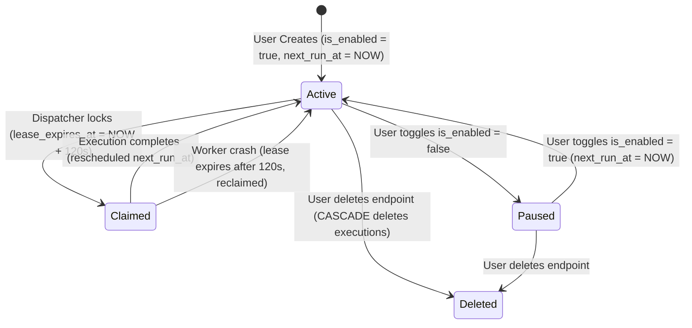
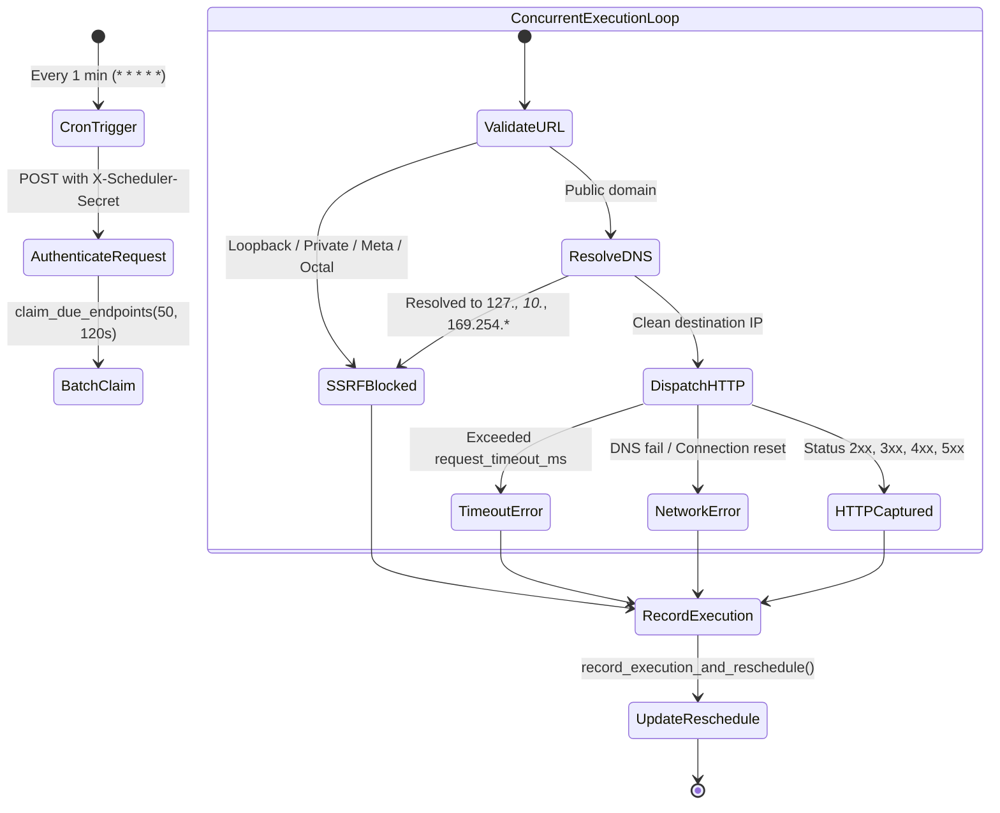

# VigilAPI Technical Design Specification

## 1. Domain Model & Database Schema

VigilAPI persists all relational state in Supabase PostgreSQL with strict Row Level Security (RLS) and schema constraints.

### 1.1 Table DDL Specifications

```sql
-- Schema Extension Prerequisites
CREATE EXTENSION IF NOT EXISTS "uuid-ossp";
CREATE EXTENSION IF NOT EXISTS "pg_cron";
CREATE EXTENSION IF NOT EXISTS "pg_net";

-- 1. Profiles Table
CREATE TABLE public.profiles (
  id UUID PRIMARY KEY REFERENCES auth.users(id) ON DELETE CASCADE,
  display_name TEXT,
  created_at TIMESTAMPTZ NOT NULL DEFAULT timezone('utc'::text, now()),
  updated_at TIMESTAMPTZ NOT NULL DEFAULT timezone('utc'::text, now())
);

-- 2. Monitored Endpoints Table
CREATE TABLE public.monitored_endpoints (
  id UUID PRIMARY KEY DEFAULT gen_random_uuid(),
  user_id UUID NOT NULL REFERENCES auth.users(id) ON DELETE CASCADE,
  name TEXT NOT NULL,
  endpoint_url TEXT NOT NULL,
  method TEXT NOT NULL DEFAULT 'GET',
  interval_seconds INTEGER NOT NULL DEFAULT 300,
  request_timeout_ms INTEGER NOT NULL DEFAULT 10000,
  query_params JSONB NOT NULL DEFAULT '{}'::jsonb,
  headers JSONB NOT NULL DEFAULT '{}'::jsonb,
  is_enabled BOOLEAN NOT NULL DEFAULT true,
  next_run_at TIMESTAMPTZ NOT NULL DEFAULT timezone('utc'::text, now()),
  last_run_at TIMESTAMPTZ,
  lease_expires_at TIMESTAMPTZ,
  created_at TIMESTAMPTZ NOT NULL DEFAULT timezone('utc'::text, now()),
  updated_at TIMESTAMPTZ NOT NULL DEFAULT timezone('utc'::text, now()),

  -- Constraints
  CONSTRAINT chk_method_get CHECK (method = 'GET'),
  CONSTRAINT chk_min_interval CHECK (interval_seconds >= 300),
  CONSTRAINT chk_timeout_range CHECK (request_timeout_ms BETWEEN 1000 AND 30000),
  CONSTRAINT chk_url_length CHECK (char_length(endpoint_url) <= 2048),
  CONSTRAINT chk_name_length CHECK (char_length(name) BETWEEN 1 AND 128)
);

-- 3. Endpoint Executions Table
CREATE TABLE public.endpoint_executions (
  id UUID PRIMARY KEY DEFAULT gen_random_uuid(),
  endpoint_id UUID NOT NULL REFERENCES public.monitored_endpoints(id) ON DELETE CASCADE,
  user_id UUID NOT NULL REFERENCES auth.users(id) ON DELETE CASCADE,
  scheduled_at TIMESTAMPTZ NOT NULL,
  started_at TIMESTAMPTZ NOT NULL,
  completed_at TIMESTAMPTZ NOT NULL,
  status_code INTEGER,
  response_time_ms INTEGER NOT NULL,
  success BOOLEAN NOT NULL,
  error_category TEXT,
  sanitized_error_message TEXT,
  response_headers JSONB NOT NULL DEFAULT '{}'::jsonb,
  response_body TEXT,
  is_truncated BOOLEAN NOT NULL DEFAULT false,
  correlation_id TEXT NOT NULL,
  created_at TIMESTAMPTZ NOT NULL DEFAULT timezone('utc'::text, now()),

  -- Constraints
  CONSTRAINT chk_error_category CHECK (
    error_category IS NULL OR
    error_category IN (
      'DNS_ERROR',
      'TIMEOUT',
      'CONNECTION_REFUSED',
      'HTTP_ERROR',
      'SSRF_BLOCKED',
      'PAYLOAD_TOO_LARGE',
      'UNKNOWN'
    )
  )
);
```

### 1.2 Performance Indexing Strategy

```sql
-- Fast index for dispatcher claim query (Filters due, enabled, non-leased endpoints)
CREATE INDEX idx_endpoints_scheduler_claim 
ON public.monitored_endpoints (next_run_at ASC, lease_expires_at) 
WHERE is_enabled = true;

-- Tenant isolation lookup
CREATE INDEX idx_endpoints_user 
ON public.monitored_endpoints (user_id, created_at DESC);

-- Endpoint-specific history lookup with pagination
CREATE INDEX idx_executions_endpoint_history 
ON public.endpoint_executions (endpoint_id, created_at DESC);

-- Tenant execution history & analytics aggregation
CREATE INDEX idx_executions_user_analytics 
ON public.endpoint_executions (user_id, created_at DESC);

-- Fast purge index for retention cleanup
CREATE INDEX idx_executions_retention_purge 
ON public.endpoint_executions (created_at ASC);
```

---

## 2. Row-Level Security (RLS) Policy Matrix

| Table | Operation | Role | Policy Expression |
| :--- | :--- | :--- | :--- |
| `profiles` | `SELECT` | `authenticated` | `auth.uid() = id` |
| `profiles` | `UPDATE` | `authenticated` | `auth.uid() = id` |
| `monitored_endpoints` | `SELECT` | `authenticated` | `auth.uid() = user_id` |
| `monitored_endpoints` | `INSERT` | `authenticated` | `auth.uid() = user_id` |
| `monitored_endpoints` | `UPDATE` | `authenticated` | `auth.uid() = user_id` |
| `monitored_endpoints` | `DELETE` | `authenticated` | `auth.uid() = user_id` |
| `endpoint_executions` | `SELECT` | `authenticated` | `auth.uid() = user_id` |
| `endpoint_executions` | `INSERT` | `authenticated` | `RESTRICTED` (Direct client inserts denied. Written only via `record_execution_and_reschedule` or `service_role`). |
| `endpoint_executions` | `UPDATE/DELETE` | `authenticated` | `DENIED` |

---

## 3. State Machines & Execution Flow

### 3.1 Monitored Endpoint State Lifecycle



### 3.2 Dispatcher Execution State Machine



---

## 4. SSRF Defense-in-Depth Architecture

### 4.1 Banned IPv4 / IPv6 Ranges

Any destination IP resolving to the following ranges is rejected immediately with error category `SSRF_BLOCKED`:

```
127.0.0.0/8             # Loopback
0.0.0.0/8               # Current network (only valid as source address)
10.0.0.0/8              # Private RFC 1918
172.16.0.0/12           # Private RFC 1918
192.168.0.0/16          # Private RFC 1918
169.254.0.0/16          # Link-Local (Cloud metadata endpoints: AWS, GCP, Azure, DigitalOcean)
100.64.0.0/10           # Carrier-Grade NAT
192.0.0.0/24            # IETF Protocol Assignments
192.0.2.0/24            # TEST-NET-1 documentation
198.18.0.0/15           # Network Interconnect Device Benchmark Testing
198.51.100.0/24         # TEST-NET-2 documentation
203.0.113.0/24          # TEST-NET-3 documentation
224.0.0.0/4             # Multicast
240.0.0.0/4             # Reserved for future use
255.255.255.255/32      # Limited Broadcast

::1/128                 # IPv6 Loopback
::/128                  # IPv6 Unspecified
::ffff:0:0/96           # IPv4-mapped IPv6 (e.g. ::ffff:127.0.0.1)
fc00::/7                # IPv6 Unique Local Address (ULA)
fe80::/10               # IPv6 Link-Local
ff00::/8                # IPv6 Multicast
```

### 4.2 Obfuscation Attacks Defended

Attackers frequently attempt to bypass basic regex filters using alternative integer, octal, and hexadecimal encodings. VigilAPI normalizes and decodes:
- Dotted Hex: `0x7f.0.0.1` $\to$ `127.0.0.1`
- Dotted Octal: `0177.0.0.1` $\to$ `127.0.0.1`
- Single Integer DWORD: `2130706433` $\to$ `127.0.0.1`
- Single Hex Integer: `0x7f000001` $\to$ `127.0.0.1`
- Cloud Metadata Decimal: `2852039166` (`169.254.169.254`) $\to$ Blocked

### 4.3 Safe Ports Allowlist

Outbound requests are strictly limited to standard web transport ports:
- `80` (HTTP)
- `443` (HTTPS)
- `8080` (Standard alternative HTTP)
- `8443` (Standard alternative HTTPS)

Any custom port specification (e.g., `http://example.com:22`, `http://example.com:5432`) is rejected at validation time.

---

## 5. Request & Response Sanitization Rules

### 5.1 Outgoing Request Header Rules
The following headers cannot be set or overridden by end users:
- `Host` (Managed by HTTP stack)
- `Authorization` (Protected from scheduler token poisoning)
- `Cookie` / `Set-Cookie`
- `Transfer-Encoding`, `Connection`, `Upgrade`, `Keep-Alive`
- `X-Forwarded-*`, `CF-*`

### 5.2 Header Redaction & Masking
When persisting or displaying custom request headers in the frontend, values associated with keys matching:
`/(auth|token|secret|key|password|credential|bearer)/i`
are stored and rendered as:
`"***REDACTED***"`

### 5.3 Allowed Inbound Response Headers
To avoid database bloat and storage of sensitive session cookies, only a strict allowlist of response headers is persisted:
- `content-type`
- `content-length`
- `server`
- `date`
- `etag`
- `cache-control`
- `last-modified`
- `x-response-time`

All other response headers (including `Set-Cookie`, `Access-Control-Allow-Origin`, internal proxy headers) are omitted.

### 5.4 Response Body Handling
- Maximum stored body length: **32,768 bytes (32 KB)**.
- If response size > 32 KB: Body is truncated, and `is_truncated = true`.
- If content-type is `application/json`: Parsed and formatted; invalid JSON preserved as raw string.
- If content-type is binary (image, audio, pdf, octet-stream): Response body is logged as `"[Binary content omitted: <content-type>]"`.

---

## 6. Frontend UI/UX Specifications

### 6.1 Theme & Layout
- **Style**: Polished, enterprise dark/light theme utilizing `@mui/material`. Deep slate backgrounds (`#0B0F19`), crisp borders (`#1E293B`), neon teal accents (`#14B8A6`) and status colors (Success `#10B981`, Warning `#F59E0B`, Error `#EF4444`).
- **Responsive Layout**: Persistent sidebar on desktop ($\ge 1200\text{px}$), collapsible drawer on tablet and mobile.

### 6.2 Key Views & Features
1. **Dashboard Overview (`/`)**:
   - 4 Top Metric Cards: Configured Endpoints, 24h Executions, Success Rate (%), Average Latency (ms).
   - High-performance Recharts visualizers:
     - 24h Execution Breakdown (Stacked Bar: Success vs. Failure).
     - Response Latency Trends (Area Chart with gradient fill).
   - Recent Failures Live Card: Immediate triage of 500s, timeouts, and network failures.
2. **Endpoints Management (`/endpoints`)**:
   - Filter chips: All, Active, Paused, Failing.
   - Search bar: Instant fuzzy search across name and URL.
   - Action controls: Pause / Resume switch, Manual "Run Test Now", Edit modal, Delete dialog.
3. **Endpoint Creation & Editing Modal**:
   - Name input with character countdown.
   - URL input with real-time SSRF and format validation indicator.
   - Preset interval selector: 5m, 10m, 15m, 30m, 1h, 6h, 12h, 24h + custom minutes.
   - Request timeout slider (1s to 30s).
   - Dynamic key-value query parameters & custom headers editor with auto-redaction preview.
4. **Execution History & Inspector (`/executions`)**:
   - Filterable data grid: Endpoint selector, Status code range, Success/Failure toggle, Date range picker.
   - Slide-over detail drawer:
     - Exact timings (Scheduled, Started, Completed, Duration ms).
     - Error category & sanitized error diagnostics.
     - Formatted JSON response viewer with copy button and truncation indicator.
     - Allowlisted response headers key-value table.
5. **Analytics Deep Dive (`/analytics`)**:
   - Latency Percentile breakdown (p50, p90, p99).
   - Error category distribution pie chart.
